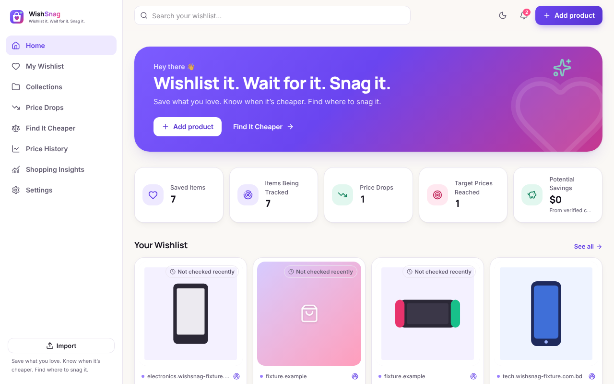
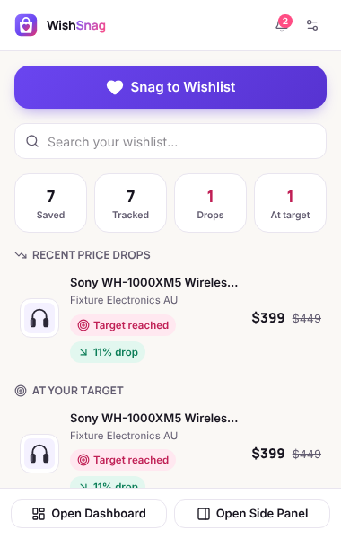
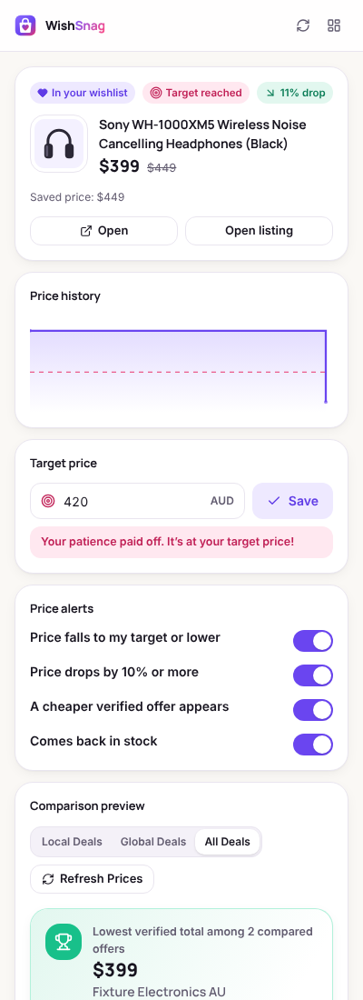
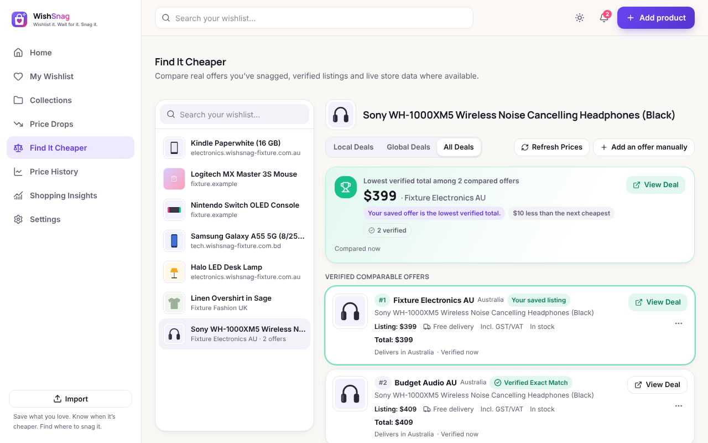

<p align="center"></p>

<h1 align="center">WishSnag</h1>
<p align="center"><b>Wishlist it. Wait for it. Snag it.</b><br>All your wants. One place. Better prices.</p>

WishSnag is a Chrome extension (Manifest V3) that lets you save products from **any** online store
into one wishlist, track **genuinely observed** prices, get alerts when they drop or hit your
target, and compare offers for the same product across stores with **honest delivered totals**.
Australia 🇦🇺 and Bangladesh 🇧🇩 are first-class launch markets; it works worldwide.



| Popup | Side panel | Find It Cheaper |
|---|---|---|
|  |  |  |

> Screenshots are from the real extension using synthetic test stores — no live retailer data.

## What it does

| Capability | Highlights |
|---|---|
| **Universal Wishlist** | Snag from the toolbar, right-click menu, side panel or <kbd>Alt</kbd>+<kbd>Shift</kbd>+<kbd>S</kbd>; layered extraction (schema.org JSON-LD → microdata → Open Graph → store adapters → visible hints → manual); review before saving; collections, tags, notes, priority, target price, purchased/archived; search, filters, 8 sorts; duplicate detection; page/URL/CSV/JSON import; JSON/CSV export |
| **Automatic Price Tracking** | Real observation history; background checks on stores you allow (paced, back-off on blocks, no cookies); records prices when you revisit saved pages; interactive 7D–All chart with stats and data-backed insights |
| **Smart Sale Alerts** | Target price, % drop, amount drop, lowest in N days, back in stock, cheaper verified offer; desktop + in-app; quiet hours, daily digest, per-item cooldown, dedupe |
| **Find It Cheaper** | Matching with confidence levels (Verified Exact / High / Possible / Different Variant — GTIN check digits, model numbers, storage/RAM/colour/size/generation/condition, Pro/Max lines, regional models, Bangla titles); Local / Global / All Deals; delivered totals that never double-count GST/VAT and mark unknown shipping/import costs as incomplete; “Lowest verified total among N compared offers” |
| **Personal Dashboard** | Home, My Wishlist, Collections, Price Drops, Find It Cheaper, Price History, Shopping Insights (incl. budget), Settings, notification centre; dark & light |
| **Global Shopping** | Independent residence / shopping market / delivery country / currency / language; every ISO currency via `Intl`; daily exchange rates with source and date; AU states & postcodes, BD 8 divisions / 64 districts / delivery zones; English + বাংলা (beta) |

Optional cloud (Supabase): sync & backup, server-side monitoring while Chrome is closed, email
alerts, live eBay offers, account deletion — see [docs/CLOUD.md](docs/CLOUD.md).

## Quick start

```bash
npm install
```

```bash
npm run build
```

Then open `chrome://extensions` → enable **Developer mode** → **Load unpacked** → choose the
`dist` folder. Full beginner guide: **[docs/INSTALL.md](docs/INSTALL.md)**.

## Scripts

| Command | What it does |
|---|---|
| `npm run build` | Production build into `dist/` (the unpacked extension) |
| `npm run dev` | Rebuild on change (reload the extension in Chrome afterwards) |
| `npm run check` | Type-check + lint + unit tests + build |
| `npm test` | Vitest unit & component tests (incl. PGlite RLS tests) |
| `npm run test:e2e` | Builds a test variant and runs Playwright against the real extension |
| `npm run package` | `release/wishsnag-<version>.zip` for the Chrome Web Store |
| `npm run icons` | Re-render PNG icons from the SVG masters |
| `node scripts/retailer-table.mjs` | Print the retailer support matrix from the registry |

Screenshots: `WS_SCREENS=1 npx playwright test screens --trace off` (writes to `test-results/screens`).
Deno tests for Edge Functions: `deno test --allow-env supabase/functions/tests/`.

## Verification status (this build)

- TypeScript strict: **0 errors** · ESLint: **0 problems**
- Unit/component tests: **144 passed** · End-to-end (real extension in Chromium): **8 passed**
  (Australian, Bangladeshi-in-Bangla, cross-border, unsupported-site, import, comparison, axe accessibility)
- Edge Functions: type-checked with Deno, **5 Deno tests passed**; RLS verified on the real migration in PostgreSQL (PGlite)

**Not verified here:** live retailer sites, live exchange-rate fetching, a live Supabase project,
eBay and Resend — this build environment had no access to them. Details and the full
implemented-vs-planned report: **[docs/STATUS.md](docs/STATUS.md)**.

## Documentation

- [docs/INSTALL.md](docs/INSTALL.md) — install, first product, dashboard, alerts, troubleshooting
- [docs/ARCHITECTURE.md](docs/ARCHITECTURE.md) — design, data flow, key decisions
- [docs/RETAILERS.md](docs/RETAILERS.md) — integration methods, per-store support matrix, research notes
- [docs/CLOUD.md](docs/CLOUD.md) — optional Supabase backend setup
- [docs/PRIVACY.md](docs/PRIVACY.md) — privacy policy
- [docs/STATUS.md](docs/STATUS.md) — implemented vs planned, final audit, release checklist
- [docs/STORE_LISTING.md](docs/STORE_LISTING.md) — Web Store copy & permission justifications

## Principles

No fabricated prices, offers or history · no simulated deals shown as live · no bypassing logins,
captchas or anti-bot measures · no cookies sent on price checks · no secrets in the extension ·
no affiliate-link rewriting · no automatic purchasing · local-first, cloud optional.

## Tech

React 19 · TypeScript (strict) · Vite 7 · Tailwind CSS 4 · Lucide · Recharts · Dexie (IndexedDB) ·
Zod · Vitest + Testing Library · Playwright + axe-core · Supabase (Postgres, RLS, Edge Functions) ·
Fonts: Inter, Manrope, Noto Sans Bengali (bundled locally).
